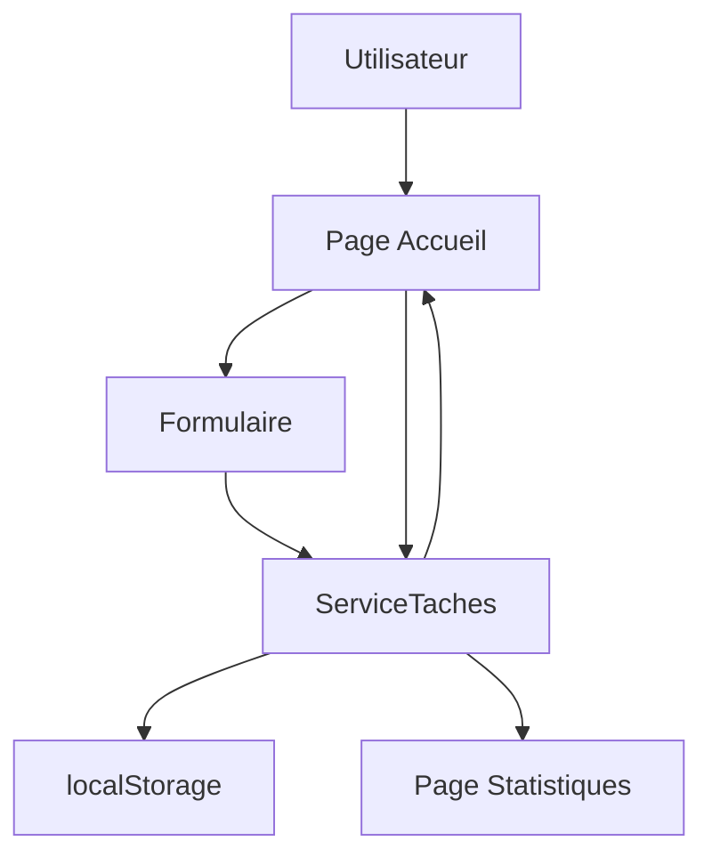

# Taskly Angular

## 1. Présentation

Taskly est une petite application Angular pour gérer des tâches.

L'utilisateur peut ajouter une tâche, une description et une échéance. Il peut aussi rechercher, filtrer, terminer, modifier ou supprimer une tâche et consulter des statistiques.

Les tâches sont gardées dans le navigateur avec `localStorage`. Il n'y a pas de serveur.

## 2. Technologies utilisées

- Angular 21 et TypeScript ;
- composants standalone ;
- Angular Router ;
- formulaires avec `ngModel` ;
- `signal` pour actualiser la liste ;
- `localStorage` pour sauvegarder les tâches ;
- CSS pour l'apparence.

## 3. Fonctionnement général



La page d'accueil appelle `ServiceTaches` pour gérer les données. Le service met à jour la liste et la sauvegarde dans le navigateur.

## 4. Les pages

| Adresse | Composant | Rôle |
| --- | --- | --- |
| `/` | `Accueil` | Gérer les tâches |
| `/stats` | `Statistiques` | Afficher les nombres |

Les routes sont dans `app.routes.ts`. Une adresse inconnue revient vers `/`.

## 5. Organisation des fichiers

```text
src/app/
├── app.ts              Composant principal
├── app.html            Menu et router-outlet
├── app.config.ts       Configuration Angular
├── app.routes.ts       Routes
├── home.ts             Logique de l'accueil
├── home.html           Affichage de l'accueil
├── stats.ts            Calcul des statistiques
├── stats.html          Affichage des statistiques
└── task.service.ts     Gestion des tâches
```

## 6. Le modèle `Tache`

Une tâche contient seulement les informations nécessaires :

```ts
export interface Tache {
  identifiant: string;
  titre: string;
  description: string;
  dateEcheance: string;
  terminee: boolean;
}
```

`terminee` vaut `false` quand la tâche est à faire et `true` quand elle est terminée.

## 7. Le service `ServiceTaches`

Le service contient la liste et les méthodes pour la modifier.

- `ajouterTache()` crée une tâche et l'ajoute à la liste ;
- `modifierTache()` change le titre, la description et la date ;
- `basculerTache()` change l'état de la tâche ;
- `supprimerTache()` enlève une tâche de la liste.

Pour changer l'état, le code utilise :

```ts
tache.terminee = !tache.terminee;
```

Une nouvelle tâche commence avec `terminee: false`.

La clé utilisée par `localStorage` est `tp-tasks-angular`. `JSON.stringify()` transforme la liste en texte pour la sauvegarder et `JSON.parse()` permet de la récupérer.

## 8. Le composant `Accueil`

`home.ts` contient les variables du formulaire :

```ts
titre = '';
description = '';
dateEcheance = '';
```

Les principales méthodes sont :

- `dateDuJour()` récupère la date actuelle ;
- `valider()` vérifie le titre et la date ;
- `ajouter()` ajoute une tâche après la validation ;
- `afficherTaches()` applique la recherche, le filtre et le tri ;
- `commencerModification()` sélectionne une tâche à modifier ;
- `enregistrer()` sauvegarde une modification ;
- `supprimer()` supprime une tâche après confirmation ;
- `terminer()` change l'état d'une tâche ;
- `compterAFaire()` et `compterTerminees()` comptent les tâches.

Les boucles `for` et les conditions `if` sont utilisées pour garder un code facile à expliquer.

## 9. Le fichier `home.html`

`[(ngModel)]` relie un champ HTML à une variable TypeScript :

```html
<input name="titre" [(ngModel)]="titre">
```

Le formulaire appelle `ajouter()` avec :

```html
<form (ngSubmit)="ajouter()">
```

Le template utilise aussi `@if` pour les conditions, `@for` pour afficher les tâches et `(click)` pour les boutons.

## 10. La page `Statistiques`

`stats.ts` utilise le même service que la page d'accueil. Il compte les tâches à faire et les tâches terminées.

`stats.html` affiche le total, les tâches à faire, les tâches terminées et le pourcentage de progression.

## 11. Le routage

Les routes sont écrites comme ceci :

```ts
export const routes: Routes = [
  { path: '', component: Accueil },
  { path: 'stats', component: Statistiques },
  { path: '**', redirectTo: '' }
];
```

Dans `app.html`, le menu contient les liens et :

```html
<router-outlet></router-outlet>
```

`router-outlet` indique où Angular affiche la page demandée.

## 12. Lancement et vérification

Depuis le dossier `eval/angular` :

```bash
npm install --legacy-peer-deps
NG_CLI_ANALYTICS=false npm start
```

Pour compiler le projet :

```bash
NG_CLI_ANALYTICS=false npm run build
```

L'application est disponible sur `http://localhost:4200/`.

## 13. Limites

- Les données restent dans le navigateur utilisé.
- Il n'y a pas de compte utilisateur.
- Il n'y a pas de serveur ni de base de données.
- Les tâches ne sont pas partagées entre plusieurs ordinateurs.
